# OrbisLink

I created this repo to make a jailbroken PS4/PS5 easier to use: a mix of Remote Play and FileZilla. Thanks to everyone who shared their code online — this repo exists because of you. Special thanks to CHIAKI and to all the devs who helped build the jailbreak. The app was built ENTIRELY by CLAUDE on the PRO plan. Use it, change it, have fun :p

A desktop app that brings together, in one window, **Remote Play** for a PS4
or PS5, **installing .pkg files by drag and drop**, and an **FTP client** for
the console.

> **Status:** stable **v1.2.0**. Remote Play works on real PS4 and PS5
> consoles (discovery, registration, 1080p/60 video, sound, microphone,
> controller and keyboard). Installing pkg files and FTP need a PS4 with
> GoldHEN, or a PS5 with a jailbreak that provides them (etaHEN). The `beta`
> branch has a lot more, still being tested on real consoles — see
> [What works, and what is in development](#what-works-and-what-is-in-development).
> The app is in English, with a Portuguese translation.

## What works, and what is in development

There are two versions: the **stable** one (v1.2.0, this branch) and the
**beta** (test builds from the `beta` branch, `vX.Y.Z-dev.N`), where new work
lands first. The app is made for the PS4 and the PS5 alike. To try the beta:
**Settings → Updates → Testing (branch builds)**, or a pre-release from the
Releases page.

| Mark | Means |
|---|---|
| ✅ | Works: confirmed on a real console (or needs no console) |
| 🧪 | Done and tested against the mock console; still to be confirmed on a real console |
| 🚧 | Not working yet, or still being built |
| — | Does not apply to that console |

### Stable (v1.2.0)

| Feature | PS4 | PS5 |
|---|---|---|
| Remote Play: discovery, registration, 1080p/60 video, sound, controller, keyboard as a controller | ✅ | ✅ |
| Microphone | 🧪 | ✅ (in a voice party) |
| Waking the console from rest mode with one click | 🧪 | 🧪 |
| FTP browser: browse, upload, download, rename, delete | ✅ (GoldHEN) | 🧪 only on the port set by hand (the beta finds it by itself) |
| Installing .pkg files by drag and drop | ✅ (Remote Package Installer) | 🚧 (in the beta: 🧪) |
| PS1/PS2 discs made into PS4 packages (no console needed) | ✅ | ✅ |
| PS1/PS2 packages sent and installed | ✅ | 🧪 sent · 🚧 installed (by hand on the console) |
| Several consoles, keyboard map, themes and colours, updates | ✅ | ✅ |

### New in the beta

| Feature | PS4 | PS5 |
|---|---|---|
| FTP found by itself when the set port is silent (2121, 1337, 21, and 9090 on a PS5) | 🧪 | ✅ |
| Files tab: moving between drives (internal ↔ USB), copied through the PC; a drop goes into the folder that is open | 🧪 | 🧪 |
| Sending any file (an ISO too) to the console's memory or a USB drive | 🧪 | 🧪 |
| PS1/PS2 packages sent over FTP (on a PS5 too, now that its FTP is found) | ✅ | ✅ |
| Installing on a PS5 without going to the console: etaHEN's DPI v2, or Prospero Manager's API when there is no DPI v2 | — | 🧪 |
| When the installer or FTP is not running, a window says what to do on that console (PS4: open Remote Package Installer, GoldHEN's FTP; PS5: Prospero Manager or DPI v2, ftpsrv or etaHEN's FTP) | ✅ | ✅ |
| **Games**: one library of every place games can be (the console's `OrbisLinkFPKG` folders, its USB drives and `data/pkg`, this PC's drives and folders), with covers, search and an *Only games* filter; the PS1/PS2 converter in its own tab | 🧪 | 🧪 |
| Games: pick several and convert or install them together; choose the console's memory, a USB drive or the extended storage | 🧪 | 🧪 |
| Games: what the console has installed (with each game's name and version), copying a game to this PC, the console's free space | 🧪 | 🧪 |
| Games: uninstalling a game or its update | 🧪 | — |
| Packing a PS4 app folder from this PC into a .pkg and installing it | 🧪 | 🧪 |
| Each package says whether it is fake (fpkg) or official, and the firmware it needs | ✅ | ✅ |
| A warning before an official package goes (it installs only with its licence), or a game needing a newer firmware than the PS4's | 🧪 | 🧪 official only (a PS5 runs PS4 games whatever their firmware) |
| Organising a folder of packages on this PC: names from what they say, install order (game, update, add-ons), a folder per game, copies left alone | ✅ | ✅ |
| Games: **cheats** for an installed game (GoldHEN's cheat repository, and etaHEN's on a PS5) sent to the console's cheat folder or taken off it | 🧪 | 🧪 |
| Games: **game patches** (illusion0001's: 60 FPS, no motion blur, skipped intros…), each with a switch for GoldHEN's game_patch plugin | 🧪 | — |
| PS5 games as folders or images (`.ffpkg`, `.exfat`) put on the home screen through ShadowMountPlus | — | 🧪 |
| **Homebrew store**: the PS5 homebrew apps of the signed homebrew.page catalog — install, update, remove; app archives (`.zip`) from this PC; a catalog address of your own | — | 🧪 |
| **Save vault**: every save backed up to this PC, sent back when the console loses it, or taken to another console of the same PSN account (PS4 ↔ PS5) | 🧪 | 🧪 |
| **Payloads**: what the console keeps in its payload and plugin folders — add, rename, delete, start at boot, run now, edit the settings files; the community's PS5 payload list | 🧪 | 🧪 |
| Remote Play: several PSN accounts, each with its own PIN, picked on the console's card | 🧪 | 🧪 |
| Remote Play: no crash when the console is showing a video app | 🧪 | 🧪 |
| Remote Play: Games, the store, the save vault and payloads open over the picture, with a slider for how see-through they are, so the game stays in sight | 🧪 | 🧪 |
| Adding a console: the search asks every network adapter and every address of a home network, and finds a console with Remote Play off by its FTP | 🧪 | 🧪 |
| One queue for every job (installs, copies, conversions, the store), kept across restarts; a system notification when a long job ends; a failed uninstall, mount or run can be tried again | 🧪 | 🧪 |
| Minimal top bar; hovering FTP or the installer shows a card with its state and what to do | ✅ | ✅ |

Everything still missing, and why, is in
[What is missing, and why](#what-is-missing-and-why).

## The interface

The screenshots show the current beta with a PS4 (GoldHEN) and a PS5
(etaHEN) side by side.

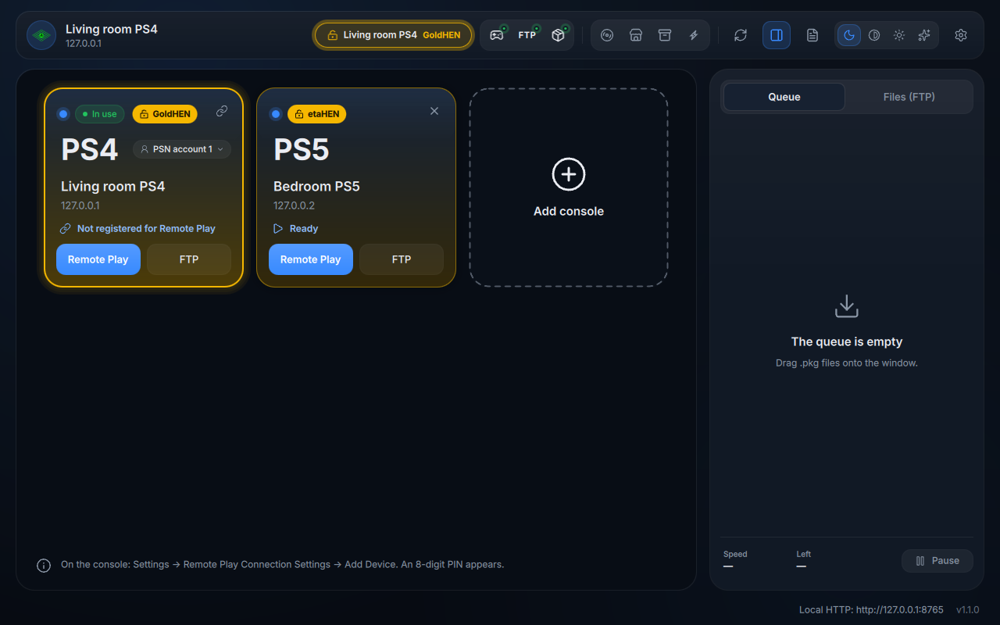

*The middle of the window is Remote Play. Each console (PS4 or PS5) has its
own box with its state. One click connects: the app checks the console,
wakes it if it is in rest mode, waits until it is ready and connects — or
opens the registration if this PC is not registered on it yet. The dashed box
adds another console, by scanning the network or by IP.*

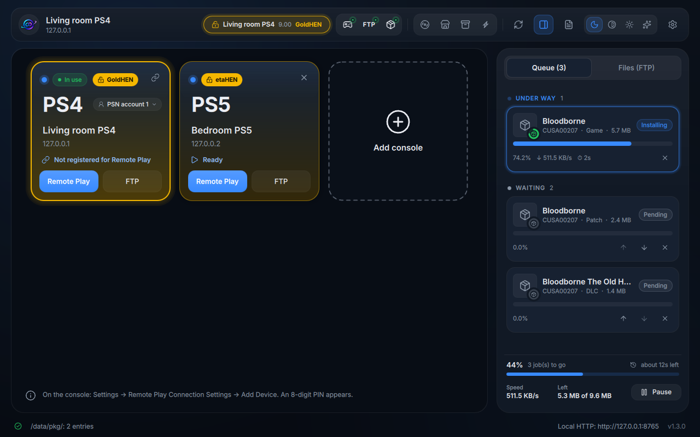

*Direct install in progress: the PC serves the pkg, the console downloads it
with `Range` requests and installs it. Game → patch → DLC go in the right
order automatically.*

| Drag and drop | FTP browser | Settings |
|---|---|---|
| 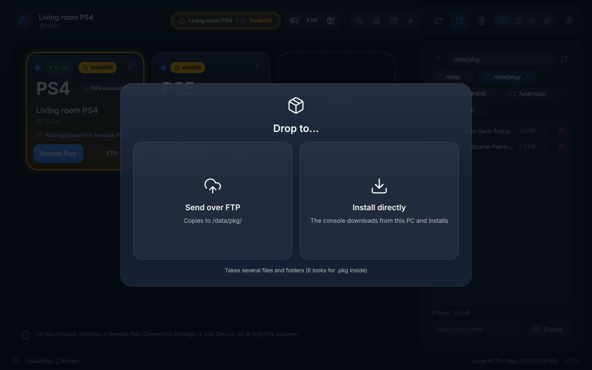 | 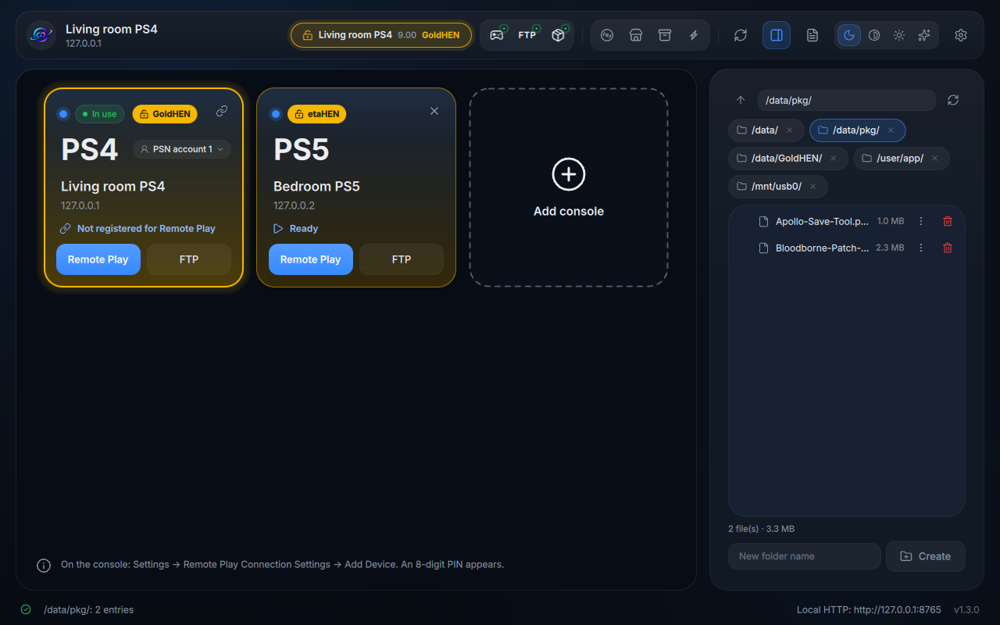 | 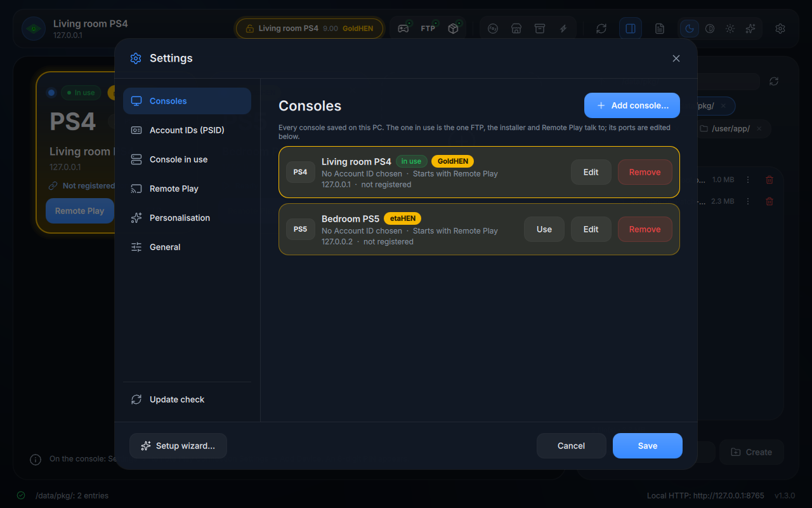 |

| Keyboard map | Light theme |
|---|---|
| 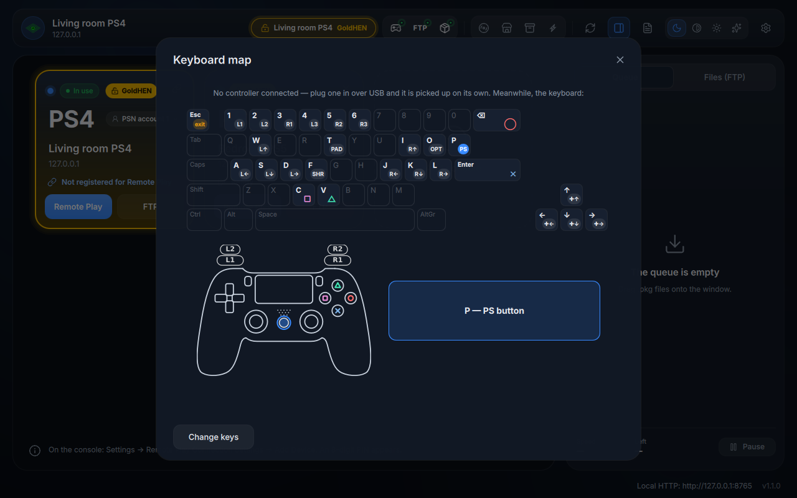 | 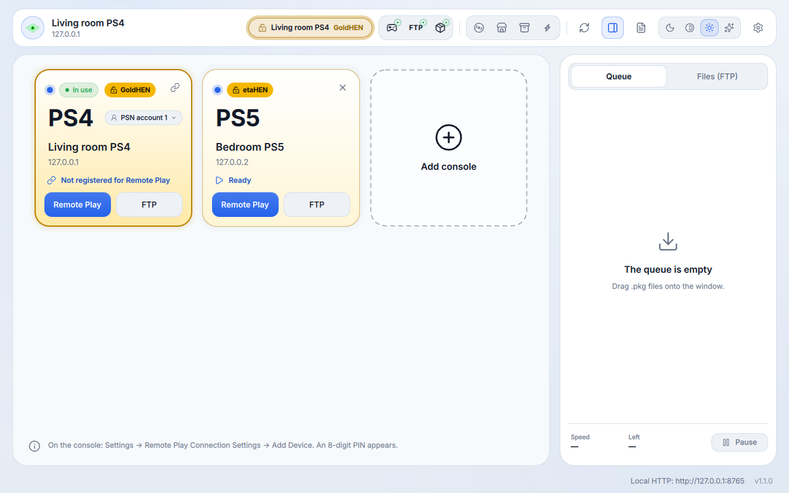 |

*With no controller connected, the keyboard acts as one. Every key can be
changed on the map, and the change is saved.*

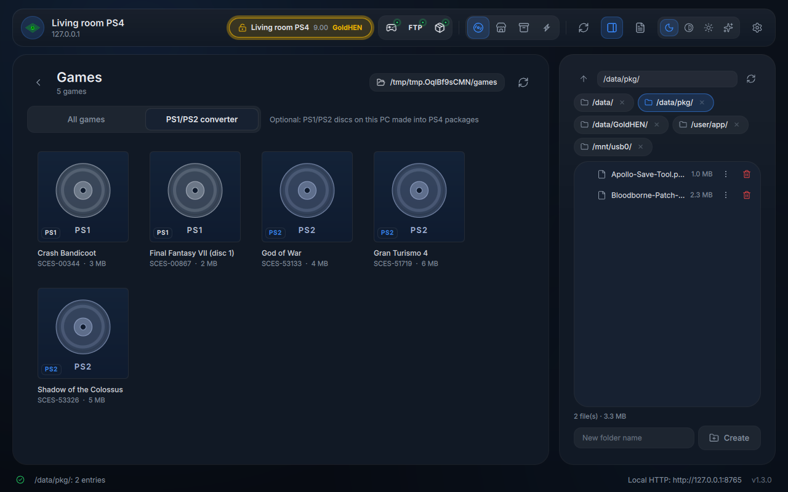

*The PS1/PS2 converter (its own page in the stable version, a tab of
**Games** in the beta): the discs in a folder of the PC (.iso, .bin/.cue,
.img), each recognised from the disc itself (serial and region). One click
opens a game; the box in the corner selects several.*

### New pages in the beta

| Games library — PS5 | Homebrew store — PS5 |
|---|---|
| 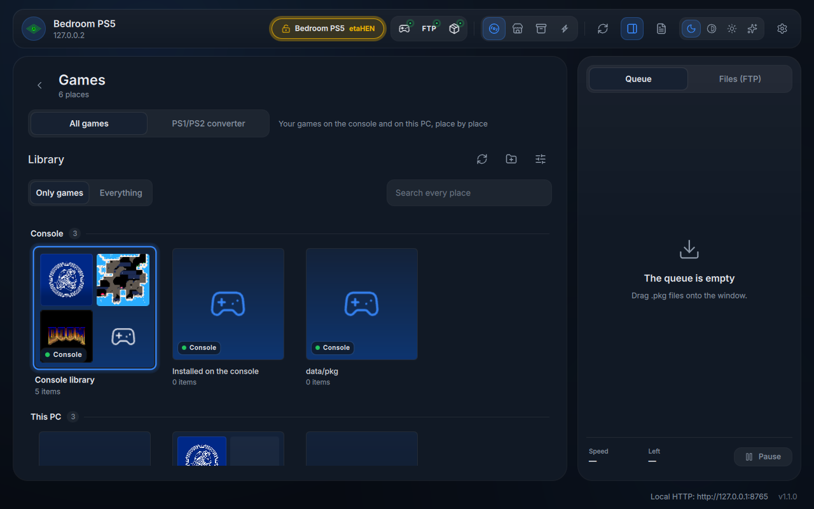 | 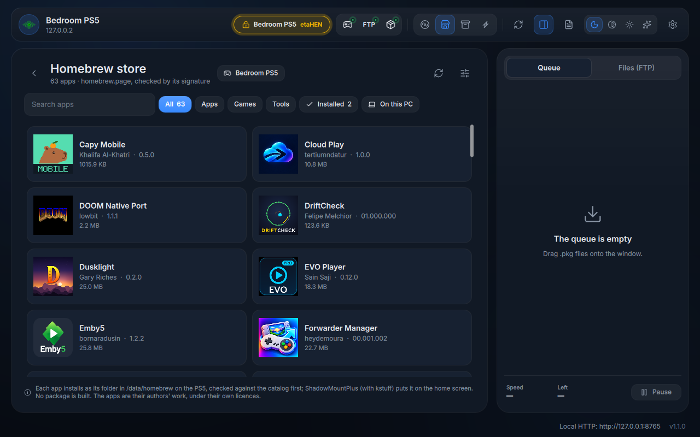 |

*Games: every place games can be, on the console and on this PC — here a
PS5's library folder, with homebrew apps beside a PS4 package. Homebrew
store: the PS5 homebrew of the homebrew.page catalog; RetroArch and VLC are
installed on this PS5.*

| Save vault — PS4 | Payloads — PS4 (GoldHEN) |
|---|---|
| 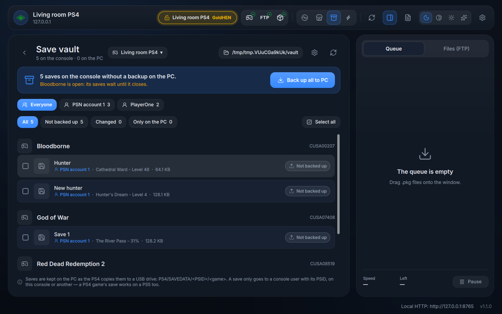 | 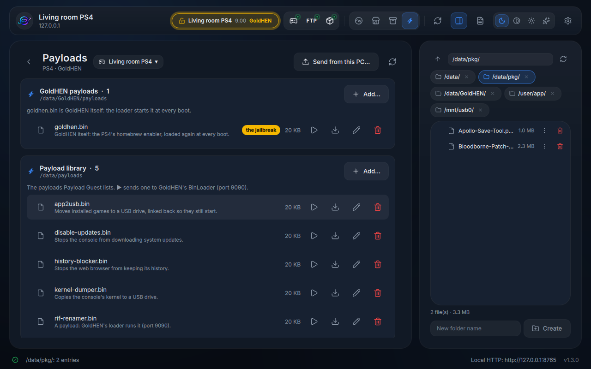 |

*Save vault: every save on the console, whose it is, and whether this PC has
a backup of it; a PS4 game's saves also go to a PS5 of the same PSN account.
Payloads: GoldHEN's payloads and plugins on a PS4 — and etaHEN's, the
autoloader's and PLDMGR's on a PS5.*

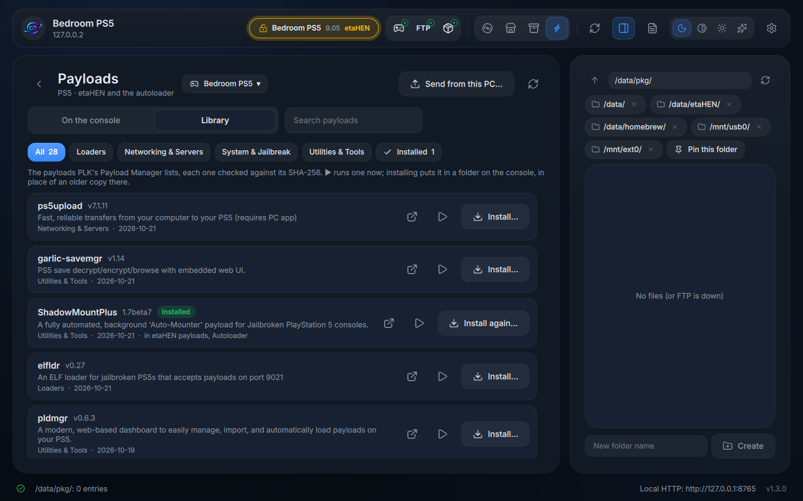

*On a PS5, the Payloads page also lists the community's payloads (the list
PLK's Payload Manager reads), each checked against its SHA-256 before use.*

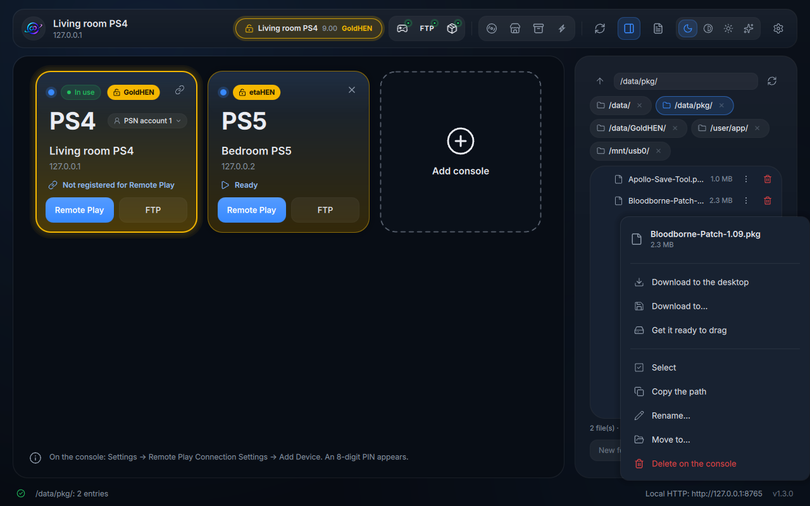

*In the FTP browser, every file and folder has its own menu: download to the
PC, prepare for dragging out of the window, copy the path, rename, delete on
the console. In the settings, the IP address is checked as you type.*

All these screenshots are generated automatically by
`./scripts/screenshots.sh` (on the `beta` branch), against two mock
consoles, a PS4 (GoldHEN) and a PS5 (etaHEN) — what they show is the real
behaviour, not mock-ups. The games, homebrew apps and payloads named in them
are real; the consoles, PSN accounts and saves are stand-ins, and no game
artwork is shown.

## Intended use

For the user's own consoles, for homebrew and copies of games the user
legally owns. **The app does not include, download, index or suggest sources
of games**, and it does not run a jailbreak: the console must already be
running GoldHEN (PS4) or a jailbreak such as etaHEN (PS5). In the beta, the
homebrew store only lists homebrew apps (from a signed catalog, or archives
on this PC), and the Payloads page starts or installs a payload only when the
user asks.

## What the console needs

| Service | Port | How to turn it on |
|---|---|---|
| Remote Play | 987/UDP (PS4), 9302/UDP (PS5), 9295/TCP, 9296–9297/UDP | enable it in the console settings and register the PC |
| PS4 — GoldHEN FTP server | 2121 | comes with GoldHEN, on by default |
| PS4 — Remote Package Installer (flatz) | 12800 | install it and **keep the app open and in the foreground** while commands are sent |
| PS5 — etaHEN FTP server | 1337 | `FTP=1` in etaHEN's `config.ini` |
| PS5 — ftpsrv payload FTP server | 2121 | load the payload (the beta finds the port by itself) |
| PS5 — etaHEN DPI v2 installer | 12800 | `DPI_v2=1` in etaHEN's `config.ini` |
| PS5 — Prospero Manager (beta, when there is no DPI v2) | 7070 | load the Prospero Manager payload |

The PS5 FTP port has its own setting, because it differs from the PS4's:
with a PS5 in use, the settings show and edit the PS5 port. In the beta,
when the set port does not greet as FTP, the app also asks the usual ones
and moves to the one that answers. Installing on a PS5 is only in the beta
(DPI v2 or Prospero Manager), and still has to be confirmed on a real PS5.

### Registering Remote Play

On a **PS4**: Settings → Remote Play Connection Settings → Add Device.
On a **PS5**: Settings → System → Remote Play → Link Device, signed in with
the account you will use.

The console shows an 8-digit PIN. Clicking the console's box in OrbisLink
opens the registration, which asks for the PIN and the PSN **Account ID** —
a 64-bit number, not the user name. The field accepts it in decimal,
hexadecimal or base64 and shows the three forms side by side. If the console
rejects it, the app says why (for example, "the console did not recognise
the Account ID").

> **The byte order matters.** Remote Play expects the 8 bytes of the Account
> ID from the least to the most significant. Converting the decimal number
> from PlayStation's site into hexadecimal and then base64 with a generic
> converter produces the reverse order. Paste the decimal number straight
> into the field and the app converts it correctly; or use the "The bytes
> are in the opposite order" switch. Each console keeps its own Account ID.

### Managing consoles

Settings → **Consoles** lists every console saved on this PC. From there you
can switch to one, rename it or change its IP, remove it, add a new one, and
forget this PC's Remote Play registration on it (the next connection then asks
for a new PIN). Registrations left behind by consoles no longer in the list
appear at the end, so they can be forgotten too.

Each console card has two buttons: **Remote Play** (the stream, with FTP and
the installer alongside) and **FTP** (only the file browser, as an alternative
to FileZilla — no jailbreak needed for Remote Play, no Remote Play needed for
FTP). A click elsewhere on the card starts the console's preferred one, chosen
when adding it or in Consoles → Edit → Start with. The FTP button only appears
when the console answers on FTP (a jailbreak: GoldHEN on the PS4, etaHEN on the
PS5); without it the card has Remote Play alone, and the preferred start stays
on Remote Play. A console with a jailbreak is drawn in gold, with a badge
saying which one it runs (GoldHEN, etaHEN, or HEN for any other) — the app
tells from the folder each one keeps in `/data`.

Settings → **Account IDs (PSID)** keeps the PSN Account IDs saved on this PC,
each under a username so they are easy to tell apart. They can be added,
edited and removed there, and each console picks the one it registers with
(Consoles → Edit → Account ID). The registration dialog can also fill the
field from a saved one.

### PS1 and PS2 games

**PS1/PS2 Games** (top bar) finds the PS1 and PS2 disc images in a folder of
the PC and shows them as cards. For each game, or several selected:

- **Convert and install** turns the disc into a PS4 package (a PS2 or PS1
  Classic), sends it to the console over FTP and installs it (Remote Package
  Installer open on the console for that last step).
- **Convert only** leaves the package in an output folder the app remembers —
  for consoles without a jailbreak, or to install later.
- **Send disc file** copies the disc image itself over FTP.

Each game's card follows it on the way, with a loader of its own per step:
amber with a spinning disc while converting, blue with a rising arrow while
sending, green with a breathing box while installing — and a ✓ when it is
done.

Nothing else has to be provided. PS2 discs are converted exactly the way
[easy-ps2-fpkg](https://github.com/spiral009/easy-ps2-fpkg) does it: the first
conversion downloads the emulator files once (about 109 MB, from the
[PS Classics fPKG Builder](https://github.com/SvenGDK/PS-Classics-fPKG-Builder)
release) and keeps them; the package gets the "Jak v2" emulator, its config
with the game's serial, its param.sfo with the game's IDs and name (from the
emulator's title list), and the game's official cover when there is one. PS1
discs use the PS1 emulator from the same download, as PS Classics fPKG
Builder does; they need a single .bin (games with one file per track have to
be joined first).

In the beta this page becomes **Games**: a library of every place games can
be, on the console and on this PC, with the PS1/PS2 converter in its own tab.

## Download (pre-built)

The binaries are produced by GitHub Actions
([the "Release" workflow](.github/workflows/release.yml)):

* **Windows x64** — `OrbisLink-<version>-setup.exe` (installer) or
  `OrbisLink-<version>-windows-x64.zip` (portable).
* **Linux x86-64** — `orbislink-<version>-linux-x86_64.tar.gz` (command line).

There are two kinds of release:

* **Stable** — `vX.Y.Z`, published on purpose from `main`
  (**Actions → Release → Run workflow** on `main`, with the version). It is
  what the repository page shows as the latest release.
* **Test builds** — `vX.Y.Z-dev.N`, published automatically on **every push**
  to the `beta` branch, as pre-releases (or by hand, with **Run workflow** and
  an empty version). Only the five most recent are kept.

There are two branches: `main` is the official one, and stable releases come
from it; `beta` is where changes land first, and they move to `main` once
tested.

The app updates itself from here: in **Settings → Updates**, the **Stable**
channel only sees final releases; the **Testing (branch builds)** channel
also sees every test build, and installs it in one click (with the SHA-256
checked before the installer runs).

The Windows installer puts the program in `C:\Program Files\OrbisLink`,
creates Start Menu shortcuts, registers the uninstaller and — if you leave
the option on — **creates the firewall rule** that lets the console download
pkg files from the PC (without it, installs stay at 0 bytes).

## Building

Dependencies: CMake ≥ 3.16, a C++17 compiler (GCC, Clang or MSVC) and
libcurl.

```bash
# Debian/Ubuntu
sudo apt install cmake build-essential libcurl4-openssl-dev

cmake -S . -B build -DCMAKE_BUILD_TYPE=RelWithDebInfo
cmake --build build
ctest --test-dir build --output-on-failure
```

On Windows, with vcpkg:

```powershell
cmake -S . -B build -DCMAKE_TOOLCHAIN_FILE=<vcpkg>/scripts/buildsystems/vcpkg.cmake
cmake --build build --config RelWithDebInfo
```

### Building the packages

```bash
./scripts/build-linux.sh      # builds, runs the tests and makes the .tar.gz

sudo apt install mingw-w64 nsis zip
./scripts/build-windows.sh    # standalone .exe + portable .zip + installer
```

`build-windows.sh` builds from Linux with mingw-w64: it builds a static
libcurl (TLS through Windows' Schannel, no OpenSSL) and links everything
statically.

## Trying it without a console

`tools/mock-console/` has a fake console: an anonymous FTP server and the
installer API on 12800, which really downloads the pkg files from the local
HTTP server with `Range` requests, just like the console does.

```bash
# terminal 1
python3 tools/mock-console/mock_console.py --ftp-port 2121 --api-port 12800

# terminal 2
python3 tools/mock-console/make_test_pkg.py /tmp/game.pkg --padding 4000000
./build/orbislink-cli inspect /tmp/game.pkg
./build/orbislink-cli services --host 127.0.0.1
./build/orbislink-cli install --host 127.0.0.1 --bind 127.0.0.1 /tmp/game.pkg
./build/orbislink-cli ftp-ls --host 127.0.0.1 /data/pkg
```

The same run happens automatically in `ctest -R integration_mock_console`.

## With a real console

```bash
./build/orbislink-cli services --host 192.168.1.42
./build/orbislink-cli install  --host 192.168.1.42 "/path/Game.pkg" "/path/Patch.pkg"
./build/orbislink-cli ftp-put  --host 192.168.1.42 "/path/Game.pkg" /data/pkg/Game.pkg
```

The local HTTP server binds by default to the interface whose subnet contains
the console's IP and only accepts requests from that IP. The first time on
Windows, the firewall asks for permission — it must be granted, or the
console cannot download from the PC.

`orbislink-cli --help` lists every command.

## Layout

```
src/orbislink/
  common/     tolerant JSON, rotating log, utilities
  net/        sockets, HTTP client (libcurl), local interface choice
  pkg/        PkgInspector, PARAM.SFO parser
  http/       LocalHttpServer (Range/206, tokens, IP restriction)
  installer/  IInstallerBackend, RpiClient, error code descriptions
  ftp/        FtpClient (libcurl)
  queue/      InstallQueue with persistence
  settings/   SettingsStore
  console/    ConsoleManager (service checks)
  stream/     Remote Play on top of chiaki-ng: discovery, registration, session
  qt/         the Qt Quick interface's controllers
qml/                  the interface
tools/cli/            orbislink-cli
tools/mock-console/   fake console + test pkg generator
tests/                unit and integration tests
docs/                 specification, validation, errors, architecture, status
packaging/windows/    installer script (NSIS) and the README that goes inside
scripts/              build, screenshot and check scripts
cmake/                cross-compilation toolchain for mingw-w64
translations/         Portuguese translation (the source language is English)
```

## Documentation

* [`docs/specification.md`](docs/specification.md) — the specification, with
  the **[VALIDATE]** points resolved.
* [`docs/validation.md`](docs/validation.md) — what was confirmed, where, and
  how it differs from the original specification.
* [`docs/error_codes.md`](docs/error_codes.md) — console error codes and the
  ones still without a source.
* [`docs/architecture.md`](docs/architecture.md) — modules, threads and flows.
* [`docs/status.md`](docs/status.md) — what is done and what is missing,
  item by item.

## If something does not work

**Drag and drop does nothing and the cursor shows the "forbidden" sign.**
The app is running as administrator. Windows does not let you drag files
from Explorer — which runs without elevated privileges — onto a window that
has them, and it blocks the messages without telling anyone. Close it and
open it from the normal shortcut; OrbisLink does not need privileges for
anything.

**Remote Play connects but there is no sound.** Export the diagnostics
(Ctrl+L → "Save report"). The *Remote Play — sound path* section shows the
nine stages between the decoder and the sound card, with their counters, and
says at which one the flow drops to zero.

**I chose 1080p and the picture did not change.** Only the PS4 Pro and the
PS5 do 1080p over Remote Play. On a regular PS4 the console itself lowers the
request to 720p — the app says so when it happens, and the stream bar shows
the real picture size and the measured fps.

**The console rejects the registration.** The app says the console's reason.
"Did not recognise the Account ID" usually means the wrong account, or the
bytes in the wrong order (see [Registering Remote Play](#registering-remote-play)).

**The window does not open at all.** See `IF THE WINDOW DOES NOT OPEN` in the
`README.txt` that comes with the installer: on machines without graphics
acceleration, the next start switches to software rendering by itself.

In every case, the diagnostics (Ctrl+L) say what happened. They do not
include the Account ID or the registration keys — only their lengths.

## What is missing, and why

The full list, checked against the code, is in
[`docs/status.md`](docs/status.md). In short:

**Remote Play over PSN.** Local network only. Connecting from outside needs
Sony's *holepunch* infrastructure, which chiaki-ng supports but which needs
an account and an authentication path this project does not have yet.

**Installing on a PS5.** The stable version only speaks Remote Package
Installer's API, which the PS5 does not have. The beta speaks etaHEN's DPI v2
and Prospero Manager's package API; both were checked against their source
and the mock console, and still have to be confirmed on a real PS5.

**PS5 game packages.** No open tool builds PS5 fake packages yet, so PS5
games and apps go on the home screen through ShadowMountPlus (beta) instead
of being installed.

**Real blur behind the glass.** The visual language is built from stacked
translucent layers. Real blur needs `QtQuick.Effects` (Qt 6.5+), and the
screenshots are built with 6.4.

**AppImage for Linux.** There is the `.tar.gz` with the command line; the
graphical interface is only distributed for Windows.

**Code signing.** The installer is not signed, so Windows shows the
SmartScreen warning on the first run. A code-signing certificate costs a few
hundred euros a year, which is not justified for a project that is not sold.

### Manual test checklist on real consoles

- [x] Remote Play discovery and registration (PS4 and PS5)
- [x] Microphone in a PS5 party
- [x] PS2 disc converted, sent and installed on a PS4 (Remote Package Installer)
- [x] FTP on a jailbroken PS5: browse, upload, move folders (beta)
- [ ] Waking a PS5 from rest mode with one click
- [ ] Stable stream during a 10 GB+ FTP upload
- [ ] Direct install of a pkg > 4 GB
- [ ] Game + patch + DLC dropped together (order gd → gp → ac)
- [ ] Network drop halfway and resume
- [ ] Windows firewall blocking → correct message
- [ ] FTP upload resume with `REST`/`APPE` (to be confirmed, see `docs/validation.md` §9)
- [ ] Install on a PS5 through DPI v2 or Prospero Manager (beta)
- [ ] Moving files between the console's drives (beta)
- [ ] Save vault: back up and send back, PS4 and PS5 (beta)
- [ ] Payloads page on a PS4 and a PS5 (beta)
- [ ] Homebrew store app installed and on the home screen of a PS5 (beta)

## Licence

**AGPL-3.0-or-later** (see [`LICENSE`](LICENSE)).

    Copyright (C) 2026 the OrbisLink authors

Remote Play comes from chiaki-ng, which is AGPL-3.0, and that licence is
contagious: if the app is distributed, the source code has to be too. That
is why this repository exists.

The copyright notices of chiaki-ng and the other libraries stay where they
are — they belong to other people and the licence requires keeping them.

The interface is set in [Inter](https://rsms.me/inter/), by Rasmus Andersson,
under the SIL Open Font License 1.1 (see [`third-party/inter`](third-party/inter)), and
its icons come from [Lucide](https://lucide.dev/), under the ISC licence (see
[`third-party/lucide`](third-party/lucide); `scripts/generate-icons.py` turns them into
`qml/orbislink/Icons.js`).

The PS1/PS2 converter builds its packages with a C++ port of the fake PKG
builder of [LibOrbisPkg](https://github.com/maxton/LibOrbisPkg), by maxton,
under the GNU LGPL 3 (see [`third-party/liborbispkg`](third-party/liborbispkg)).
PS2 packages are made as [easy-ps2-fpkg](https://github.com/spiral009/easy-ps2-fpkg)
(MIT) makes them, PS1 packages as
[PS Classics fPKG Builder](https://github.com/SvenGDK/PS-Classics-fPKG-Builder)
does; covers come from [xlenore/ps2-covers](https://github.com/xlenore/ps2-covers).
No Sony emulator, firmware or game is part of OrbisLink: like easy-ps2-fpkg,
it downloads the emulator files at run time from PS Classics fPKG Builder's
release.

Sources consulted to implement the protocols:
[chiaki-ng](https://github.com/streetpea/chiaki-ng),
[Remote Package Installer](https://github.com/flatz/ps4_remote_pkg_installer),
[GoldHEN](https://github.com/GoldHEN/GoldHEN),
[etaHEN](https://github.com/etaHEN/etaHEN) and the
[OpenOrbis PS4 Toolchain](https://github.com/OpenOrbis/OpenOrbis-PS4-Toolchain).
In the beta, telling official packages from fake ones, the firmware a package
needs and organising a folder of packages follow
[PS4 PKG Tool](https://github.com/pearlxcore/PS4PKGTool), by pearlxcore
(GPL-3.0), rewritten in C++.
The beta's cheats come from the
[GoldHEN Cheat Repository](https://github.com/GoldHEN/GoldHEN_Cheat_Repository)
and [etaHEN's PS5 cheats](https://github.com/etaHEN/PS5_Cheats), its game
patches from [illusion0001's PS4-PS5-Game-Patch](https://github.com/illusion0001/PS4-PS5-Game-Patch),
all downloaded at run time (none is part of OrbisLink).
